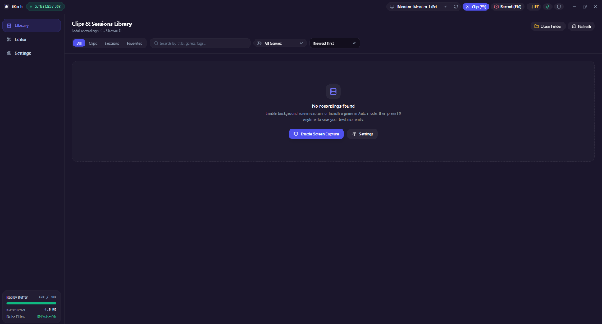

<div align="center">

# iKoch

**Lightweight Windows game & screen replay recorder and built-in clip editor**  
**Лёгкий рекордер откатов и сессий для Windows со встроенным видеоредактором**

[](https://github.com/its-lemon/iKoch/releases/latest)
[](https://github.com/its-lemon/iKoch/releases/latest)
[](#build-from-source)
[](Cargo.toml)

[English](#-english) • [Русский](#-русский) • [Download Latest Release / Скачать](https://github.com/its-lemon/iKoch/releases/latest)

</div>

---

## 🇬🇧 English

**iKoch** is a fast, low-overhead Windows replay recorder and clip editor built with **Rust**, **Tauri v2**, and **React**. It captures games and monitors using **Windows Graphics Capture (WGC)** + GPU hardware encoding (**NVIDIA NVENC / AMD AMF / Intel QuickSync**) and **WASAPI** multi-track audio, while keeping background tray RAM usage minimal.

<p align="center">
  
</p>

### ✨ Key Features
- **Instant Replay Buffer (`F9`)** — always-on circular RAM buffer (15–300s) saving along clean IDR keyframe boundaries.
- **Full Session Recording (`F10`)** — crash-safe fragmented MP4 recording with automatic `faststart` remuxing.
- **Auto Game Detection** — automatically detects launched games, pauses when unfocused/minimized, or captures a chosen monitor/window.
- **Multi-Track WASAPI Audio** — records `Mixed Audio` (default playback track) + separate `Game`, `Microphone` (with **RNNoise**, **Noise Gate**, **Soft Limiter**, Push-to-Talk), and optional `Secondary` tracks.
- **Built-in Clip Editor** — lossless trim, multi-segment cut, playback speed (`0.25x–4.0x`), `16:9` / `9:16` (blurred Shorts) / `1:1`, per-track volume mixer, Discord size presets (`10 MB` / `50 MB` / custom), GIF & PNG frame export, `Ctrl+V` file copy (`CF_HDROP`).
- **Themes & Bilingual UI** — `EN` / `RU` interface, 8 built-in themes + live Custom Theme Builder.
- **Zero-RAM Tray Background** — closing the window destroys the WebView2 UI process while keeping the Rust recording daemon alive in the system tray.

### 📁 Organized Media Folders
Inside your configured clips folder (default: `%USERPROFILE%\Videos\iKoch\`):
- **`Clips\<Game or Screen>\`** — instant replay clips (`F9`)
- **`Edited\`** — all exports from the Editor (trims, `9:16`, Discord compress, GIF, PNG, sub-clips)
- **`Sessions\<Game or Screen>\`** — full-length session recordings (`F10`)

Metadata (`.json`), thumbnails (`.jpg`), temporary stems (`.tmp`), and logs are stored out-of-band in `%LOCALAPPDATA%\iKoch\` so your video folders stay clean.

### ⌨️ Default Hotkeys
| Shortcut | Action |
|---|---|
| `F9` | Save instant replay clip |
| `F10` | Start / stop full session recording |
| `F7` | Add bookmark marker |
| `F6` | Mute / unmute microphone |
| `Ctrl+Shift+P` | Toggle Privacy Mode (pauses capture & clears buffer) |

### 🛠 Build from Source
1. Install **Rust (1.82+)** and **Node.js (20+)**.
2. Place FFmpeg sidecars into `src-tauri/binaries/` (excluded from Git due to GitHub's 100 MiB file limit):
   - **Windows:** `ffmpeg-x86_64-pc-windows-msvc.exe` and `ffprobe-x86_64-pc-windows-msvc.exe`
   - **Linux:** static `ffmpeg-x86_64-unknown-linux-gnu` and `ffprobe-x86_64-unknown-linux-gnu` (or symlink system binaries: `ln -sf /usr/bin/ffmpeg src-tauri/binaries/ffmpeg-x86_64-unknown-linux-gnu && ln -sf /usr/bin/ffprobe src-tauri/binaries/ffprobe-x86_64-unknown-linux-gnu`)
3. Run:
   ```powershell
   npm install
   npx tauri build
   ```

---

## 🇷🇺 Русский

**iKoch** — быстрый и лёгкий рекордер откатов и игровых сессий для Windows на базе **Rust**, **Tauri v2** и **React**. Захват видео работает через **Windows Graphics Capture (WGC)** с аппаратным кодированием GPU (**NVIDIA NVENC / AMD AMF / Intel QuickSync**), а звук пишется через **WASAPI** сразу в несколько дорожек при минимальной нагрузке на систему.

<p align="center">
  
</p>

### ✨ Основные возможности
- **Мгновенный откат (`F9`)** — кольцевой буфер в ОЗУ (15–300 сек), сохраняющий клип ровно по ключевым кадрам (IDR).
- **Полная запись сессий (`F10`)** — отказоустойчивая запись в `.fmp4` с автоматическим ремуксом в `faststart` MP4.
- **Автоопределение игр** — сам находит запущенную игру, ставит запись на паузу при сворачивании (Alt+Tab) или захватывает выбранный монитор/окно.
- **Многодорожечный звук (WASAPI)** — итоговый микс (`Mixed Audio`) + отдельные дорожки `Игра`, `Микрофон` (**RNNoise**, **Noise Gate**, **Soft Limiter**, Push-to-Talk) и дополнительный источник.
- **Встроенный редактор** — быстрая обрезка без перекодирования, склейка фрагментов, скорость (`0.25x–4.0x`), форматы `16:9` / `9:16` (вертикальный с размытием) / `1:1`, микшер громкости дорожек, сжатие под Discord (`10 МБ` / `50 МБ` / свой размер), экспорт в GIF и PNG, копирование файла в буфер (`Ctrl+V`).
- **Темы и языки** — русский и английский интерфейс, 8 готовых тем + конструктор своей темы в реальном времени.
- **Фоновый режим без расхода ОЗУ** — при закрытии окна процесс WebView2 выгружается полностью, а лёгкий демон записи продолжает работать в системном трее.

### 📁 Порядок в папке с видео
Внутри выбранной папки клипов (по умолчанию `%USERPROFILE%\Videos\iKoch\`):
- **`Clips\<Игра или Screen>\`** — мгновенные клипы (`F9`)
- **`Edited\`** — все файлы из Редактора (обрезка, `9:16`, сжатие под Discord, GIF, PNG, sub-clips)
- **`Sessions\<Игра или Screen>\`** — длинные записи сессий (`F10`)

Метаданные (`.json`), превью (`.jpg`), временные файлы (`.tmp`) и логи хранятся отдельно в `%LOCALAPPDATA%\iKoch\`, не засоряя папки с видео.

### ⌨️ Горячие клавиши по умолчанию
| Клавиша | Действие |
|---|---|
| `F9` | Сохранить мгновенный клип (откат) |
| `F10` | Начать / остановить запись сессии |
| `F7` | Поставить закладку (маркер) |
| `F6` | Включить / выключить микрофон |
| `Ctrl+Shift+P` | Режим приватности (пауза захвата и очистка буфера) |

### 🛠 Сборка из исходников
1. Установите **Rust (1.82+)** и **Node.js (20+)**.
2. Поместите бинарники FFmpeg в `src-tauri/binaries/` (исключены из Git из-за лимита GitHub в 100 МБ):
   - **Windows:** `ffmpeg-x86_64-pc-windows-msvc.exe` и `ffprobe-x86_64-pc-windows-msvc.exe`
   - **Linux:** статические `ffmpeg-x86_64-unknown-linux-gnu` и `ffprobe-x86_64-unknown-linux-gnu` (или симлинки на системные: `ln -sf /usr/bin/ffmpeg src-tauri/binaries/ffmpeg-x86_64-unknown-linux-gnu && ln -sf /usr/bin/ffprobe src-tauri/binaries/ffprobe-x86_64-unknown-linux-gnu`)
3. Выполните:
   ```powershell
   npm install
   npx tauri build
   ```
