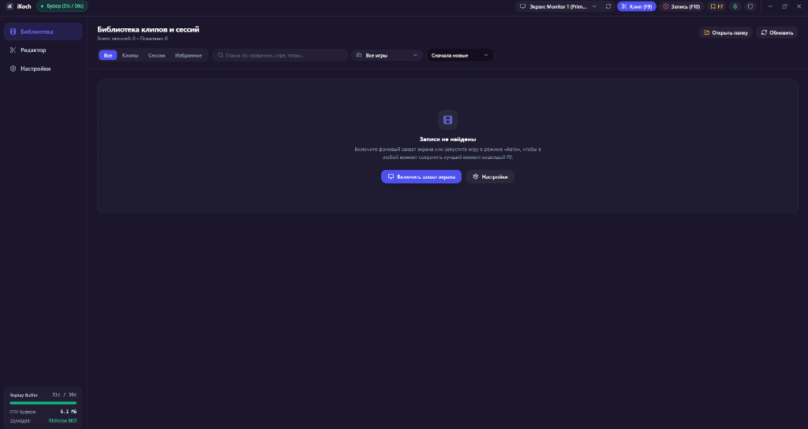

# iKoch

**Lightweight game & screen replay recorder and built-in clip editor**  
**Лёгкий рекордер откатов и сессий со встроенным видеоредактором**

[English](#-english) • [Русский](#-русский) • [Download Latest Release / Скачать](https://github.com/its-lemon/iKoch/releases/latest)

---

## 🇬🇧 English

**iKoch** is a fast, low-overhead replay recorder and clip editor built with **Rust**, **Tauri v2**, and **React**.
- **Windows (`main` branch):** captures games and monitors using **Windows Graphics Capture (WGC)** + GPU hardware encoding (**NVIDIA NVENC / AMD AMF / Intel QuickSync**) and **WASAPI** multi-track audio.
- **Linux (`linux` branch — Experimental / CI-Verified):** developed in a separate [`linux`](https://github.com/its-lemon/iKoch/tree/linux) branch so it never conflicts with the Windows build.

  

### ✨ Key Features
- **Instant Replay Buffer (`F9`)** — always-on circular RAM buffer (15–300s) saving along clean IDR keyframe boundaries.
- **Full Session Recording (`F10`)** — crash-safe fragmented MP4 recording with automatic `faststart` remuxing.
- **Auto Game Detection** — automatically detects launched games, pauses when unfocused/minimized, or captures a chosen monitor/window (supports native Linux games and Proton/Wine).
- **Multi-Track Audio** — records `Mixed Audio` (default playback track) + separate `Game`, `Microphone` (with **RNNoise**, **Noise Gate**, **Soft Limiter**, Push-to-Talk), and optional `Secondary` tracks.
- **Built-in Clip Editor** — lossless trim, multi-segment cut, playback speed (`0.25x–4.0x`), `16:9` / `9:16` (blurred Shorts) / `1:1`, per-track volume mixer, Discord size presets (`10 MB` / `50 MB` / custom), GIF & PNG frame export, `Ctrl+V` file copy (`CF_HDROP` / `text/uri-list`).
- **Themes & Bilingual UI** — `EN` / `RU` interface, 8 built-in themes + live Custom Theme Builder.
- **Zero-RAM Tray Background** — closing the window destroys the WebView UI process while keeping the Rust recording daemon alive in the system tray.

### 🐧 Linux Support (`linux` branch — Experimental / CI-Verified)
The Linux backend lives in the dedicated [`linux`](https://github.com/its-lemon/iKoch/tree/linux) branch:
- **Capture:** priority `gpu-screen-recorder` backend (Vice-style) when installed in `PATH`, with automatic built-in fallback to `xdg-desktop-portal` (`ashpd`) + **PipeWire** + **GStreamer** (`nvh264enc` / `vaapih264enc` / `x264enc`).
- **Audio:** **PipeWire / PulseAudio** (`libpulse-binding`) with the same 3/4-track layout and `nnnoiseless` RNNoise suppression.
- **Desktop Integration:** Wayland `GlobalShortcuts` Portal / X11 / `evdev` (`/dev/input/event*` via `input` group), `libayatana-appindicator3` tray (gracefully opens main window without tray if absent), `~/.config/autostart/ikoch.desktop`, `wl-copy` / `xclip`, D-Bus / `xdg-open`.
- **Install:** download `.AppImage` or `.deb` from **[Releases](https://github.com/its-lemon/iKoch/releases)** (or **Actions → Artifacts** on the `linux` branch).

### 📁 Organized Media Folders
Inside your configured clips folder (default: `%USERPROFILE%\Videos\iKoch\` on Windows, `~/Videos/iKoch/` on Linux):
- **`Clips/<Game or Screen>/`** — instant replay clips (`F9`)
- **`Edited/`** — all exports from the Editor (trims, `9:16`, Discord compress, GIF, PNG, sub-clips)
- **`Sessions/<Game or Screen>/`** — full-length session recordings (`F10`)

Metadata (`.json`), thumbnails (`.jpg`), temporary stems (`.tmp`), and logs are stored out-of-band (`%LOCALAPPDATA%\iKoch\` on Windows, `~/.local/share/iKoch/` on Linux) so your video folders stay clean.

### ⌨️ Default Hotkeys
| Shortcut | Action |
|---|---|
| `F9` | Save instant replay clip |
| `F10` | Start / stop full session recording |
| `F7` | Add bookmark marker |
| `F6` | Mute / unmute microphone |
| `Ctrl+Shift+P` | Toggle Privacy Mode (pauses capture & clears buffer) |

### 🛠 Build from Source
- **Windows (`main` branch):** install **Rust 1.82+** & **Node.js 20+**, place `ffmpeg-x86_64-pc-windows-msvc.exe` & `ffprobe-x86_64-pc-windows-msvc.exe` in `src-tauri/binaries/`, then run `npm install && npx tauri build`.
- **Linux (`linux` branch):** `git clone -b linux https://github.com/its-lemon/iKoch.git`, install `webkit2gtk-4.1`, `libayatana-appindicator3`, `gstreamer`, `pipewire`, `libpulse`, `ffmpeg` (optional: `gpu-screen-recorder` + `input` group), symlink `ffmpeg`/`ffprobe` to `src-tauri/binaries/*-x86_64-unknown-linux-gnu`, then run `npm install && npx tauri build`.

---

## 🇷🇺 Русский

**iKoch** — быстрый и лёгкий рекордер откатов и игровых сессий со встроенным редактором на базе **Rust**, **Tauri v2** и **React**.
- **Windows (ветка `main`):** захват через **Windows Graphics Capture (WGC)** с аппаратным кодированием GPU (**NVIDIA NVENC / AMD AMF / Intel QuickSync**) и многодорожечный звук **WASAPI**.
- **Linux (ветка `linux` — Experimental / CI-Verified):** разрабатывается в отдельной ветке [`linux`](https://github.com/its-lemon/iKoch/tree/linux), чтобы никак не конфликтовать со сборкой для Windows.

  

### ✨ Основные возможности
- **Мгновенный откат (`F9`)** — кольцевой буфер в ОЗУ (15–300 сек), сохраняющий клип ровно по ключевым кадрам (IDR).
- **Полная запись сессий (`F10`)** — отказоустойчивая запись в `.fmp4` с автоматическим ремуксом в `faststart` MP4.
- **Автоопределение игр** — сам находит запущенную игру, ставит запись на паузу при сворачивании (Alt+Tab) или захватывает выбранный монитор/окно (поддерживает и нативные Linux-игры, и Proton/Wine).
- **Многодорожечный звук** — итоговый микс (`Mixed Audio`) + отдельные дорожки `Игра`, `Микрофон` (**RNNoise**, **Noise Gate**, **Soft Limiter**, Push-to-Talk) и дополнительный источник.
- **Встроенный редактор** — быстрая обрезка без перекодирования, склейка фрагментов, скорость (`0.25x–4.0x`), форматы `16:9` / `9:16` (вертикальный с размытием) / `1:1`, микшер громкости дорожек, сжатие под Discord (`10 МБ` / `50 МБ` / свой размер), экспорт в GIF и PNG, копирование файла в буфер (`Ctrl+V`).
- **Темы и языки** — русский и английский интерфейс, 8 готовых тем + конструктор своей темы в реальном времени.
- **Фоновый режим без расхода ОЗУ** — при закрытии окна процесс WebView выгружается полностью, а лёгкий демон записи продолжает работать в системном трее.

### 🐧 Поддержка Linux (ветка `linux` — Experimental / CI-Verified)
Linux-версия развивается в отдельной ветке [`linux`](https://github.com/its-lemon/iKoch/tree/linux):
- **Захват:** приоритетный бэкенд `gpu-screen-recorder` (по принципу Vice) при наличии в `PATH`, и встроенный fallback через `xdg-desktop-portal` (`ashpd`) + **PipeWire** + **GStreamer** (`nvh264enc` / `vaapih264enc` / `x264enc`).
- **Звук:** **PipeWire / PulseAudio** (`libpulse-binding`) с 3/4 дорожками и шумоподавлением `nnnoiseless`.
- **Интеграция:** Wayland `GlobalShortcuts` Portal / X11 / `evdev` (`/dev/input/event*` через группу `input`), трей `libayatana-appindicator3` (если отсутствует — окно открывается напрямую без падений), `~/.config/autostart/ikoch.desktop`, `wl-copy` / `xclip`, D-Bus / `xdg-open`.
- **Установка:** скачайте `.AppImage` или `.deb` из **[Releases](https://github.com/its-lemon/iKoch/releases)** (или из **Actions → Artifacts** ветки `linux`).

### 📁 Порядок в папке с видео
Внутри выбранной папки клипов (по умолчанию `%USERPROFILE%\Videos\iKoch\` на Windows, `~/Videos/iKoch/` на Linux):
- **`Clips/<Игра или Screen>/`** — мгновенные клипы (`F9`)
- **`Edited/`** — все файлы из Редактора (обрезка, `9:16`, сжатие под Discord, GIF, PNG, sub-clips)
- **`Sessions/<Игра или Screen>/`** — длинные записи сессий (`F10`)

Метаданные (`.json`), превью (`.jpg`), временные файлы (`.tmp`) и логи хранятся отдельно (`%LOCALAPPDATA%\iKoch\` на Windows, `~/.local/share/iKoch/` на Linux), не засоряя папки с видео.

### ⌨️ Горячие клавиши по умолчанию
| Клавиша | Действие |
|---|---|
| `F9` | Сохранить мгновенный клип (откат) |
| `F10` | Начать / остановить запись сессии |
| `F7` | Поставить закладку (маркер) |
| `F6` | Включить / выключить микрофон |
| `Ctrl+Shift+P` | Режим приватности (пауза захвата и очистка буфера) |

### 🛠 Сборка из исходников
- **Windows (ветка `main`):** установите **Rust 1.82+** и **Node.js 20+**, поместите `ffmpeg-x86_64-pc-windows-msvc.exe` и `ffprobe-x86_64-pc-windows-msvc.exe` в `src-tauri/binaries/`, затем `npm install && npx tauri build`.
- **Linux (ветка `linux`):** `git clone -b linux https://github.com/its-lemon/iKoch.git`, установите `webkit2gtk-4.1`, `libayatana-appindicator3`, `gstreamer`, `pipewire`, `libpulse`, `ffmpeg` (опционально `gpu-screen-recorder` + группа `input`), сделайте симлинки `ffmpeg`/`ffprobe` в `src-tauri/binaries/*-x86_64-unknown-linux-gnu`, затем `npm install && npx tauri build`.
  Подробная инструкция для Ubuntu/Debian и Arch/CachyOS — в [README.ru.md](README.ru.md).
