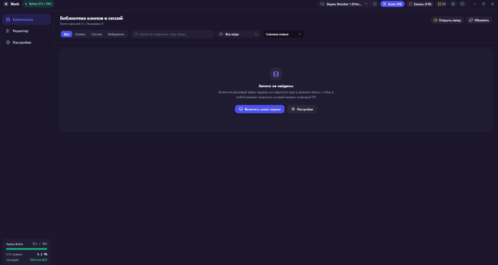

<div align="center">

# iKoch

**Простая и лёгкая программа для записи игровых моментов (откатов) и монтажа клипов на Windows**

[](https://github.com/its-lemon/iKoch/releases/latest)
[](https://github.com/its-lemon/iKoch/releases/latest)
[](Cargo.toml)

[English](README.md) • [Русский](README.ru.md) • [Скачать последний релиз](https://github.com/its-lemon/iKoch/releases/latest)

</div>

---

**iKoch** помогает сохранять лучшие игровые моменты одним нажатием клавиши, записывать длинные видео, быстро обрезать или склеивать клипы прямо внутри программы и отправлять их в Discord — без тормозов и лишней нагрузки на ПК.

<p align="center">
  
</p>

### ✨ Что умеет iKoch
- **Сохранение последних моментов (`F9`)** — программа держит в памяти последние 15 секунд – 5 минут игры и сохраняет клип по нажатию кнопки. Можно включить **очистку буфера после клипа**, чтобы в следующем клипе не повторялись уже сохранённые секунды.
- **Обычная запись видео (`F10`)** — записывайте долгие игровые сессии или экран целиком, запись не потеряется даже при сбое.
- **Умное определение игр** — сама находит запущенную игру, ставит запись на паузу при сворачивании (Alt+Tab) или позволяет выбрать конкретный монитор/окно.
- **Раздельный звук для игры, микрофона и программ** — меняйте громкость игры, голоса (с подавлением шума клавиатуры и кулеров) и отдельных приложений вроде Discord или Spotify независимо друг от друга. Пока программа не запущена, она не тратит ресурсы.
- **Удобный встроенный редактор** — быстрая обрезка (можно сохранить новым файлом или заменить оригинал), склейка нескольких клипов в один, изменение скорости, микшер громкости каждой дорожки, сжатие под лимит Discord (`10 МБ` / `50 МБ`), копирование готового видео в буфер обмена (`Ctrl+V`).
- **Свой стиль и подсказки** — русский и английский язык, 8 тем + настройка любых цветов под себя и понятные подсказки `(?)` рядом с каждой настройкой.
- **Обновления в один клик** — сама проверяет новые версии на GitHub и позволяет обновиться прямо из Настроек.
- **Лёгкий фоновый режим** — когда вы закрываете окно, интерфейс полностью выгружается из памяти, а запись по горячим клавишам продолжает работать в трее.

### 📁 Где лежат ваши видео
Внутри выбранной папки (по умолчанию `Видео\iKoch\`):
- **`Clips\<Игра или Screen>\`** — мгновенные клипы (`F9`)
- **`Edited\`** — клипы после обрезки, склейки или сжатия под Discord
- **`Sessions\<Игра или Screen>\`** — полные записи сессий (`F10`)

### ⌨️ Горячие клавиши по умолчанию
| Клавиша | Что делает |
|---|---|
| `F9` | Сохранить мгновенный клип |
| `F10` | Начать / остановить полную запись |
| `F8` | Поставить закладку на таймлайне |
| `Ctrl+Shift+M` | Включить / выключить микрофон |
| `Ctrl+Shift+P` | Режим приватности (пауза записи и очистка памяти) |

<details>
<summary><b>🛠 Технические детали и сборка из исходников (для разработчиков)</b></summary>

- **Стек:** Rust + Tauri v2 + React + TypeScript.
- **Захват и видео:** Windows Graphics Capture (WGC) с zero-copy D3D11 -> аппаратное кодирование GPU (NVIDIA NVENC / AMD AMF / Intel QuickSync), кольцевой GOP-буфер в ОЗУ с сохранением по ключевым кадрам (IDR), отказоустойчивая запись `.fmp4` с автоматическим ремуксом в `faststart` MP4.
- **Аудио-ядро:** многодорожечный WASAPI (`Mixed Audio` по умолчанию + отдельные стемы `Game`, `Microphone` с `nnnoiseless` RNNoise + noise gate + soft limiter + PTT/PTM, опциональный `Secondary` и ленивый WASAPI Process Loopback `AudioApp(u8)` через `IAudioSessionManager2`).
- **Редактор и интеграции:** FFmpeg/FFprobe sidecar (lossless-обрезка `-c copy`, склейка сегментов, динамический `amix` микшер, расчёт битрейта под Discord), копирование файла в буфер Windows через `CF_HDROP`, автообновление через GitHub Releases API.
- **Служебные файлы:** `.json`-сайдкар метаданных, `.jpg`-превью, временные `.tmp`-стемы и логи хранятся отдельно в `%LOCALAPPDATA%\iKoch\`.

**Сборка из исходников:**
1. Установите **Rust (1.82+)** и **Node.js (20+)**.
2. Поместите `ffmpeg-x86_64-pc-windows-msvc.exe` и `ffprobe-x86_64-pc-windows-msvc.exe` в `src-tauri/binaries/` (исключены из Git из-за лимита GitHub в 100 МБ).
3. Выполните:
   ```powershell
   npm install
   npx tauri build
   ```

</details>
